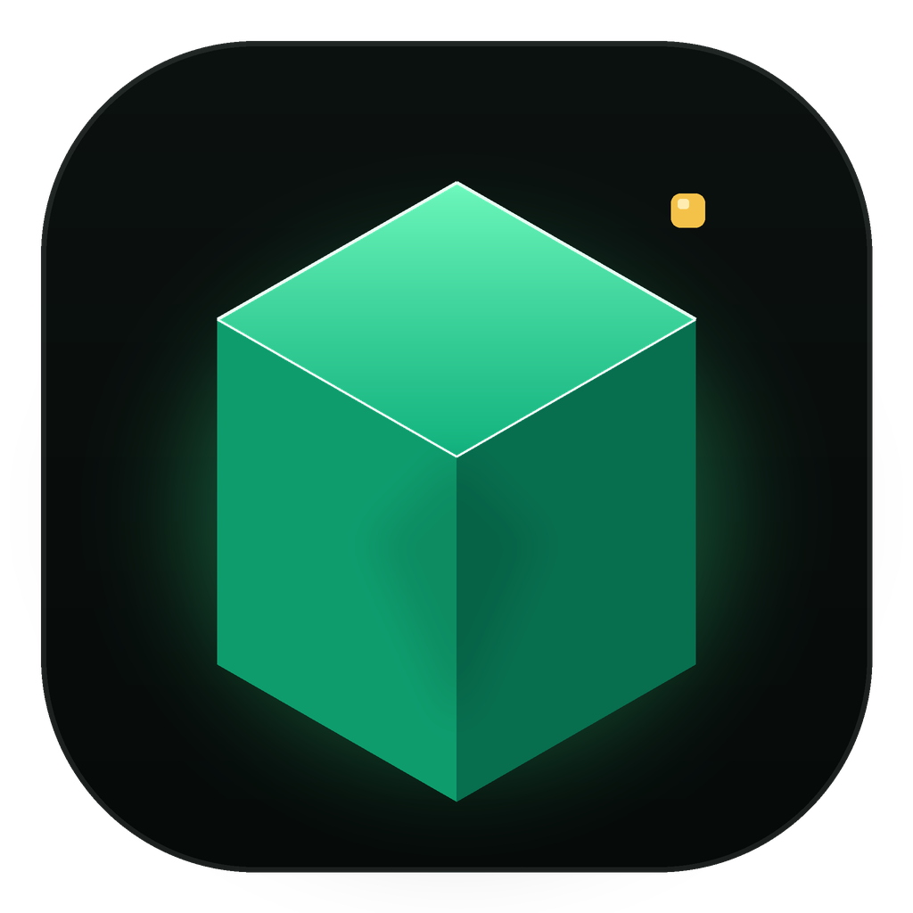
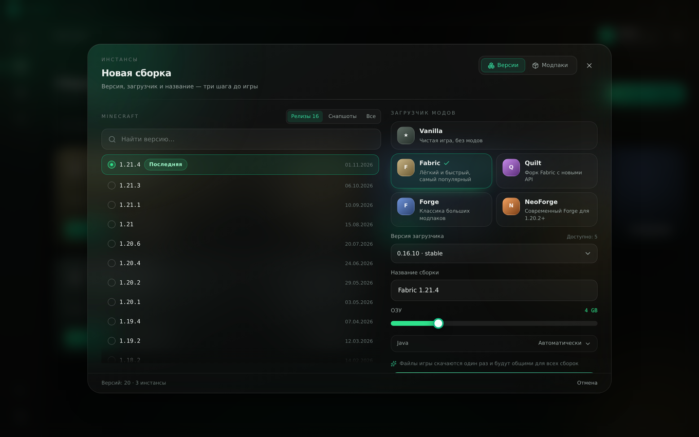
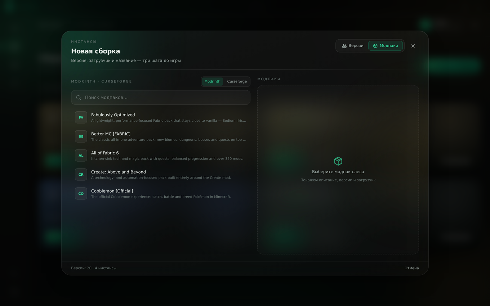
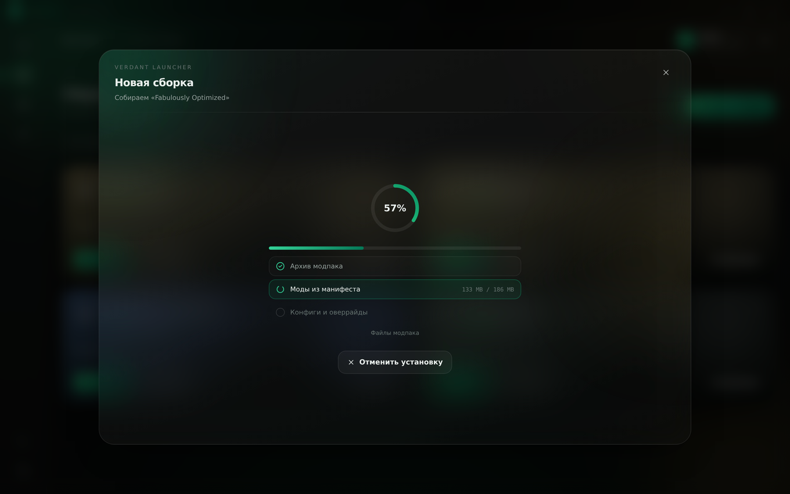
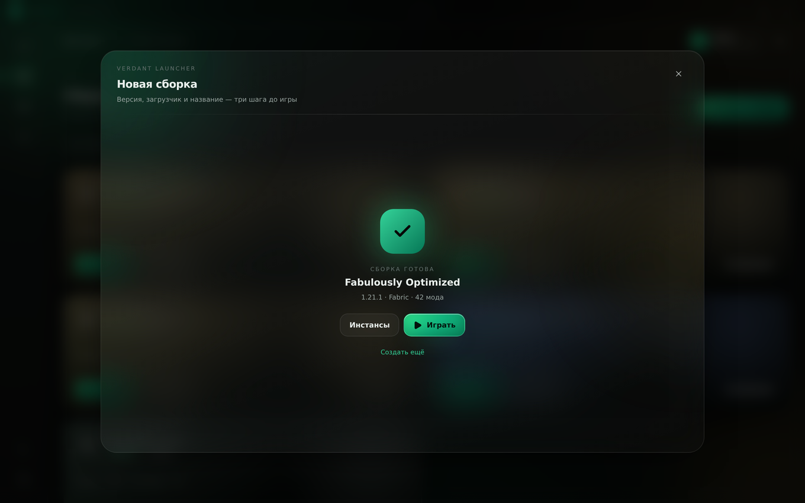

# Verdant Launcher

Премиальный лаунчер Minecraft: стеклянный интерфейс, изолированные сборки,
offline-профиль, моды из Modrinth в один клик и консоль с подсветкой.

Electron 45 · React 18 · TypeScript · Vite 7 · Tailwind CSS 4 · SCSS · Zustand · Framer Motion
Ядро запуска: `@xmcl/core` + `@xmcl/installer`.

[](https://github.com/BalaRmack/html-editor1/releases/download/v1.0.0/Verdant-Launcher-1.0.0-Setup.exe)
[](https://github.com/BalaRmack/html-editor1/releases/tag/v1.0.0)
[](https://github.com/BalaRmack/html-editor1/actions/workflows/ci.yml)



> **Готовый установщик:** [Verdant-Launcher-1.0.0-Setup.exe](https://github.com/BalaRmack/html-editor1/releases/download/v1.0.0/Verdant-Launcher-1.0.0-Setup.exe)
> · страница релиза: [v1.0.0](https://github.com/BalaRmack/html-editor1/releases/tag/v1.0.0)
> · подробный отчёт о работе: [docs/REPORT.md](docs/REPORT.md)

---

## Быстрый старт

```bash
npm install          # Node.js >= 22.12
npm run dev          # запуск Electron-приложения (main + preload + renderer, HMR)
```

Другие команды:

| Команда | Что делает |
|---|---|
| `npm run dev` | Electron в режиме разработки с горячей перезагрузкой |
| `npm run preview:ui` | Только интерфейс в браузере (порт 4173, mock-бэкенд) — удобно для UI-ревью |
| `npm run typecheck` | Strict TypeScript: main + preload + renderer + тесты |
| `npm test` | Юнит-тесты ядра (UUID, maven, JVM-аргументы, PNG, launch args) |
| `npm run test:ui` | Smoke-тесты React-интерфейса в jsdom |
| `npm run build` | typecheck + сборка в `out/` |
| `npm run package` | Сборка Windows NSIS-установщика в `release/` (локально, нужен Windows/Wine) |

### Живые тесты API

```bash
VERDANT_NET_TESTS=1 npx vitest run tests/network.test.ts
```

Проверяют реальные Mojang / Fabric / Forge / NeoForge / Modrinth эндпоинты:
скачивают version.json и client.jar Minecraft 1.20.1, парсят версию, собирают
командную строку Java. По умолчанию пропускаются (нужен интернет).

---

## Что реализовано

### Аккаунт (offline)
- Валидация ника как в Minecraft: 3–16 символов, `A–Z 0–9 _`.
- UUID = `UUID.nameUUIDFromBytes("OfflinePlayer:<ник>")` — MD5 с патчем версии/variant,
  побайтно совпадает с Java (тест: `Notch` → `b50ad385-829d-3141-a216-7e7d7539ba7f`).
- Профиль и скин (PNG 64×64 / 64×32) хранятся локально, предпросмотр рисуется на canvas.

### Инстансы
- Каждая сборка — отдельный каталог `instances/<uuid>/minecraft` (свои `mods/`, `saves/`, `config/`)
  и свой `instance.json` (версия, загрузчик, RAM, JVM-аргументы, Java, заметки).
- Общий кеш `shared/{versions,libraries,assets}` — как в Prism/Modrinth App, экономит гигабайты.
- Создание, клонирование (включая моды и миры), переименование, удаление, кастомная иконка.
- **Модальное окно «Новая сборка»** с двумя вкладками:
  - *Версии* — список версий из официального манифеста Mojang (фильтры «Релизы / Снапшоты / Все» + поиск),
    карточки загрузчиков (Vanilla, Fabric, Quilt, Forge, NeoForge) с выбором версии загрузчика,
    имя сборки, ОЗУ и Java прямо в окне.
  - *Модпаки* — поиск по Modrinth и CurseForge, карточка сборки, список версий,
    «Установить как сборку»: архив скачивается, манифест определяет Minecraft и загрузчик,
    файлы раскладываются по папкам сборки, оверрайды копируются, загрузчик ставится автоматически.
- Живой прогресс: кольцо с общим процентом, чек-лист этапов (файлы игры → загрузчик → библиотеки,
  либо архив → моды → конфиги), байты «скачано / всего» и кнопка отмены задачи.

| Версии | Модпаки |
| --- | --- |
|  |  |

| Прогресс установки | Готово |
| --- | --- |
|  |  |

### Запуск игры
- Vanilla, Fabric, Quilt, Forge, NeoForge (`@xmcl/installer`; Forge post-processors выполняются).
- Автопоиск Java: реестр Windows (`JavaSoft`, Adoptium, Zulu, BellSoft, Microsoft…), стандартные пути,
  `PATH`, `JAVA_HOME`, `~/.jdks`, `/usr/lib/jvm`; при отсутствии — скачивание рантайма Mojang.
- Проверка целостности библиотек/ассетов и докачка битых файлов при каждом запуске.
- Извлечение нативов в `instances/<id>/.natives/<version>`, корректный classpath,
  G1GC-флаги по умолчанию, пользовательские JVM-аргументы (с разбором кавычек).
- Crash-report перехватывается и показывается красивым модальным окном + пишется в лог.

### Моды
- Modrinth API: поиск с фасетами по версии игры и загрузчику, сортировки, пагинация.
- Установка в один клик с рекурсивным разрешением required-зависимостей (Fabric API и т.п.).
- CurseForge — через официальный API с ключом пользователя (в настройках), прокси не нужен.
- Список установленных модов: включить/отключить (`.disabled`), удалить, открыть папку, счётчик в карточке сборки.
- Установка модпаков `.mrpack` (Modrinth) и CurseForge-манифестов в новый изолированный инстанс.

### Настройки и консоль
- Слайдер ОЗУ с цветовой индикацией (зелёный / жёлтый / красный) относительно объёма ПК.
- Вкладка Java: найденные рантаймы, ручной выбор, скачивание Mojang JRE 8/17/21.
- Продвинутые JVM-аргументы с пресетами.
- Консоль: цвета по уровню (ERROR/WARN/INFO/DEBUG), автоскролл, фильтры, «Копировать всё»,
  кольцевой буфер 5000 строк + зеркало в `logs/launcher.log`.

---

## Архитектура

```
src/
├─ shared/       типы домена + контракт IPC (используется всеми тремя процессами)
├─ preload/      contextBridge: фиксированный API window.launcher (никакого generic invoke)
├─ main/
│  ├─ ipc/       регистрация каналов, валидация, единый формат ошибок {code, message}
│  └─ services/  paths · config-store · offline · profile · instances · versions
│                net · java · installer · launch · modrinth · curseforge · mods
│                logger · tasks
└─ renderer/src/
   ├─ i18n/      RU + EN словари
   ├─ store/     Zustand (профиль, сборки, настройки, логи, задачи, тосты)
   ├─ components/  glass-примитивы, layout (титлбар/сайдбар/топбар), SkinPreview
   └─ features/  play · instances · CreateInstance (модалка) · mods · skins · settings · console
```

Безопасность: `contextIsolation: true`, `nodeIntegration: false`, `sandbox: false` (preload требует
`require('electron')`), CSP, запрет навигации и `window.open`, внешние ссылки — только `shell.openExternal`.
Renderer не имеет доступа к `fs`/`path`/`child_process` — только к `window.launcher`.

Данные (по умолчанию, меняется в настройках):

```
%APPDATA%\Verdant\
├─ config.json
└─ data\
   ├─ shared\{versions,libraries,assets}
   ├─ instances\<uuid>\{instance.json,icon.png,minecraft\}
   ├─ java\
   ├─ skins\
   └─ logs\launcher.log
```

---

## CI/CD

| Workflow | Триггер | Что делает |
|---|---|---|
| `.github/workflows/ci.yml` | push в `main` / `arena/**`, PR | typecheck, юнит- и UI-тесты, сборка; отдельный job — живые тесты Mojang/Fabric/Modrinth |
| `.github/workflows/release.yml` | тег `v*` | тесты → сборка → `electron-builder` NSIS `.exe` → GitHub Release с артефактом |

Релиз:

```bash
git tag v1.0.0
git push origin v1.0.0
```

Установщик создаёт ярлыки на Рабочем столе и в меню «Пуск», иконку приложения
(`build/icon.ico`), поддерживает выбор папки установки. Артефакт — `Verdant-Launcher-<version>-Setup.exe`.

---

## Лицензия

MIT. Verdant Launcher не аффилирован с Mojang Studios / Microsoft. Minecraft — торговая марка Mojang Synergies AB.
